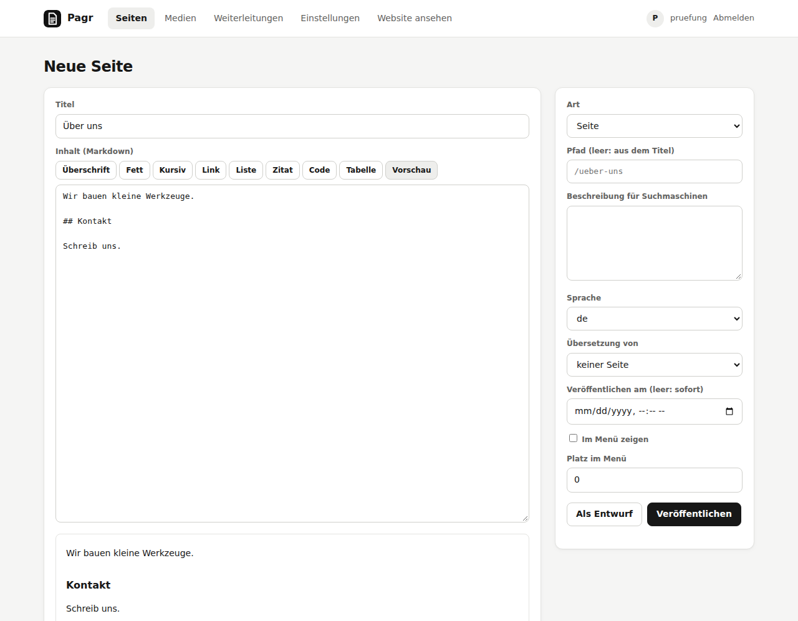

<p align="center"></p>
<h1 align="center">Pagr</h1>
<p align="center">Content-Management für kleine Websites: schreiben, planen, veröffentlichen, sauber ausliefern.</p>



## Was es kann

| Bereich | Funktionen |
|---|---|
| Schreiben | Markdown ohne rohes HTML, Bausteine, Vorschau, Absätze mit Alt und Pfeil verschieben |
| Veröffentlichen | Entwürfe, Zeitplan, 50 Versionen je Seite mit Vergleich |
| Aufbau | Seiten, Beiträge, Menü, sprechende Pfade, Weiterleitungen (beim Umbenennen von selbst) |
| Sprachen | je Seite eine Sprache, Übersetzungen verweisen aufeinander, Menü je Sprache |
| Medien | Bilder, PDF, Video, Audio, Bildbreiten 480, 960 und 1600 über `?b=` |
| Auffindbar | Beschreibung, Open Graph, Canonical, Sitemap, RSS unter `/feed.xml` |
| Designs | Ruhig, Klar, Magazin, jeweils hell und dunkel |
| Export | die ganze veröffentlichte Website als ZIP für jeden Webserver |

## Rollen

| Rolle | darf |
|---|---|
| Autor | eigene Entwürfe schreiben, Medien hochladen (Vorgabe für neue Personen) |
| Redaktion | alles veröffentlichen, Menü, Medien, Weiterleitungen, Export |
| Admin | dazu Einstellungen, Personen, Anmeldung |

## Starten

```bash
cp .env.beispiel .env            # Kennwort für die Datenbank eintragen
docker compose up -d --build
docker compose logs pagr         # Link mit Einrichtungscode
```

Die Website liegt unter `http://<host>:8360`, die Redaktion unter `/admin`. Das
erste Konto aus dem Link verwaltet die App. Wer nur OIDC benutzt, trägt den
Admin in `PAGR_ADMIN` ein. Für den Betrieb gehört TLS davor.

## Grenzen

* Medien liegen lokal im Volume, nicht in S3.
* WebP wird gelesen, verkleinerte Fassungen entstehen als JPEG oder PNG.
* Gedrehte Handyfotos, GIF und AVIF werden im Original ausgeliefert.
* Medien sind für alle abrufbar, die ihre Adresse kennen, auch vor dem Veröffentlichen.

## Entwickeln

```bash
go run .
go test ./...
# mit Datenbank; sie wird geleert, der Name muss mit pruef beginnen
PAGR_TEST_DB=postgres://.../pruef_pagr go test ./...
```

Go 1.27.4, PostgreSQL 17. Das Schema steht in `schema.sql`.

## Lizenz

MIT, siehe [LICENSE](LICENSE).
